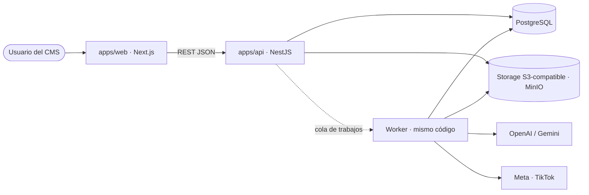
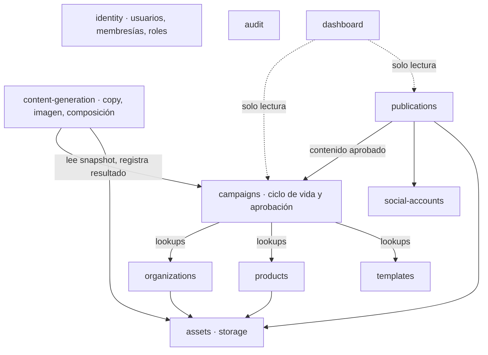
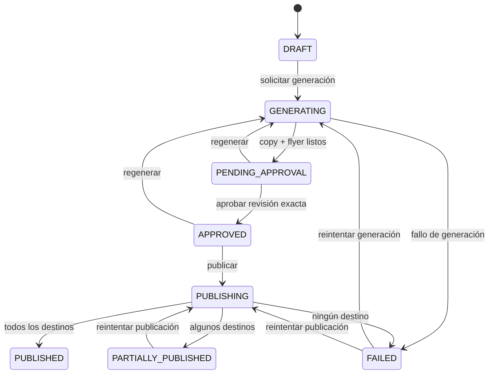

# Visión de arquitectura

Actualizado el 14 de noviembre de 2026. Describe el sistema **como está hoy** y la **arquitectura objetivo** acordada. Las diferencias entre ambas están en la [evaluación](evaluacion-2026-11.md) y se ejecutan según la [hoja de ruta](../fases/estado.md).

## Qué es Creovexa

Plataforma para que una empresa genere publicidad con IA a partir de su catálogo: registra productos o servicios, crea una campaña, la IA produce el texto y el flyer, una persona lo revisa y aprueba, y el sistema lo publica en Facebook, Instagram y TikTok registrando el resultado de cada destino.

**Escala esperada:** hasta unas 20 organizaciones, un solo desarrollador y presupuesto de infraestructura bajo. "Escalable" significa aquí que el código pueda crecer sin romperse y que el aislamiento por organización ya permita crecer en clientes sin rediseñar.

## Contexto del sistema



La línea punteada y el worker son arquitectura objetivo ([ADR-0008](../adr/0008-cola-de-trabajos-y-worker.md)). Hoy la API llama a la IA dentro del request HTTP y todavía no existe integración con redes sociales.

## Estilo

Monolito modular con arquitectura hexagonal ([ADR-0001](../adr/0001-monolito-modular-hexagonal.md)). Cada módulo tiene cuatro capas y las dependencias apuntan hacia adentro:

```
presentation  →  application  →  domain
infrastructure ───────────────→  application / domain (implementa sus contratos)
```

- `domain`: entidades con comportamiento, value objects, errores y contratos de repositorio. TypeScript puro.
- `application`: casos de uso y ports hacia el exterior. TypeScript puro.
- `infrastructure`: Prisma, clientes de IA, storage, renderer.
- `presentation`: controllers, requests y responses HTTP.

Verificado en noviembre de 2026: ningún archivo de `domain` ni `application` importa NestJS ni Prisma.

## Mapa de módulos

### Hoy

| Módulo | Responsabilidad | Contrato |
| --- | --- | --- |
| `organizations` | Empresa, perfil de marca y logo | [contrato](../modulos/organizations/contrato.md) |
| `products` | Catálogo de productos y servicios, precio e imagen única | [contrato](../modulos/products/contrato.md) |
| `templates` | Plantillas de flyer con revisiones inmutables | [contrato](../modulos/templates/contrato.md) |
| `campaigns` | Campaña: ciclo de vida, contenido generado y aprobación | [contrato](../modulos/campaigns/contrato.md) |
| `content-generation` | Generación de copy e imagen con IA y composición del flyer | [contrato](../modulos/content-generation/contrato.md) |
| `publications` | Resultado e intentos por destino social | [contrato](../modulos/publications/contrato.md) |
| `dashboard` | Indicadores de solo lectura | [contrato](../modulos/dashboard/contrato.md) |
| `assets` | Almacenamiento privado e inmutable de archivos | [contrato](../modulos/assets/contrato.md) |

### Objetivo



Ya hecho: `campaigns` dividido en tres ([ADR-0010](../adr/0010-dividir-campaigns.md)) y un módulo NestJS por módulo de negocio ([ADR-0011](../adr/0011-cableado-nestjs-por-modulo.md)). Falta: `identity`, `social-accounts` y `audit`.

## Reglas entre módulos

1. Un módulo nunca importa entidades ni repositorios de otro. Se comunica mediante **ports de consulta** definidos por el consumidor (por ejemplo `ProductLookup` en `campaigns`) e identificadores. Cuando hace falta algo más que una consulta, el módulo proveedor publica un `contract.ts` con datos planos, y es lo único que el otro puede importar ([ADR-0021](../adr/0021-contrato-publicado-entre-modulos.md)).
2. Toda consulta y escritura lleva `organizationId` ([ADR-0003](../adr/0003-aislamiento-por-organizacion.md)).
3. Los datos que una campaña necesita de otros módulos se copian en un snapshot inmutable al solicitar la generación ([ADR-0016](../modulos/campaigns/adr/0016-snapshot-inmutable-por-generacion.md)); lo que cambie después en el catálogo no altera una generación en curso ni una ya aprobada.
4. El trabajo lento o que depende de terceros (IA, render, publicación) se ejecuta en el worker, no en el request ([ADR-0008](../adr/0008-cola-de-trabajos-y-worker.md)).

## Flujo principal



`FAILED` guarda su origen (`failureOrigin`: generación o publicación), que determina qué reintento admite.

Los estados son los del enum `CampaignStatus`. Las transiciones exactas las protege la entidad `Campaign`; el diagrama es un resumen.

## Despliegue

Decisión pendiente. Con el presupuesto actual, el objetivo es que todo corra en un solo VPS con Docker Compose: `web`, `api`, `worker`, `postgres` y storage S3-compatible. La cola usa PostgreSQL, por lo que no hace falta Redis. Chromium (Playwright) solo sería necesario si se mantiene el modo de composición ([ADR-0009](../adr/0009-estrategia-de-generacion-del-flyer.md)).
